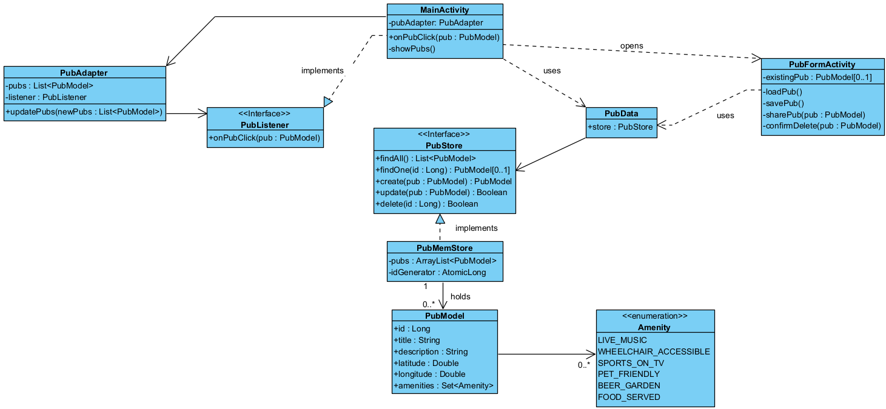

# 🍺 Pubs & Bars Finder

Pubs & Bars Finder is an Android app for discovering pubs and bars, helping users find the best venues to gather and socialise. Users can save the places they like, describe them, record their location and amenities, and share them with friends.

## ✨ Features

- Add a pub with a title, description, amenities and coordinates
- Input validation: a title is required, and coordinates must be within valid ranges (a comma is accepted as the decimal separator)
- List all saved pubs as cards, showing the description, formatted coordinates (for example 53.3448° N, 6.2765° W) and amenities
- Empty-state message when no pubs have been saved yet
- Tap a pub to open it for editing
- Delete a pub from the edit screen, with a confirmation dialog
- Share a pub through any app (messaging, email and so on), including a Google Maps link to its location
- Amenities: live music, wheelchair accessible, sports on TV, pet friendly, beer garden and food served
- Console (CLI) menu with full CRUD operations for testing the data layer

## 🛠️ Tech stack

- **Language:** Kotlin
- **Platform:** Android (minimum SDK 24, target SDK 36)
- **UI:** XML layouts with ViewBinding, Material Components
- **Lists:** RecyclerView with a custom adapter
- **IDE:** Android Studio

## 📁 Project structure

```
app/src/main/java/com/pubsbarsfinder/app/
├── MainActivity.kt        # Main screen: list of pubs
├── PubFormActivity.kt     # Add/edit screen: form, delete and share
├── PubData.kt             # Shared pub store used by all screens
├── adapters/
│   ├── PubAdapter.kt      # RecyclerView adapter for the pub list
│   └── PubListener.kt     # Click listener interface for list items
├── models/
│   ├── PubModel.kt        # Pub data class and Amenity enum
│   ├── PubStore.kt        # Data store interface
│   └── PubMemStore.kt     # In-memory implementation of PubStore
└── main/
    └── Main.kt            # Console (CLI) runner

app/src/main/res/
├── layout/                # Screen and list item layouts
├── menu/                  # Action bar menu
├── drawable/              # Field and card backgrounds, icons
└── values/                # Strings, colours and themes

docs/                      # Project documentation
```

## 🏗️ Design

- **Data layer:** built around a `PubStore` interface, implemented by an in-memory store (`PubMemStore`). Screens only depend on the interface, so a different implementation, such as a JSON file store, can replace it without changing the rest of the app.
- **Immutable model:** `PubModel` is a data class with read-only properties. Changes create updated copies with `copy()`, and every change goes through the store.
- **Shared store:** a single `PubData` object holds the store, so all screens work with the same data.
- **List interactions:** the adapter reports taps through the `PubListener` interface, implemented by the main screen, which keeps the adapter independent of other screens.
- **Resources:** all user-visible text is defined in `strings.xml`, and colours are named by their role in `colors.xml`.



## 🌿 Git workflow

- Work is planned and tracked with GitHub **issues**, grouped into **milestones**.
- Issues are categorised with **labels** according to the type of work.
- Each feature is developed on its own **branch**, linked to its issue, and merged into `main` through a **pull request**.
- Commit messages follow the [Conventional Commits](https://www.conventionalcommits.org/) style and reference the related issue.
- Releases are tagged on GitHub, with release notes generated from the merged pull requests.

## 🚀 How to run

1. Clone the repository:
   ```bash
   git clone https://github.com/guilhermeoliveirateo/Pubs-Bars-Finder
   ```
2. Open the project in Android Studio and let Gradle sync.
3. Create or start an Android virtual device (Tools → Device Manager).
4. Run the app with **Run ▶** (Shift + F10).

To run the console menu instead, open `main/Main.kt` and click the ▶ icon next to `fun main()`, then choose **Run 'MainKt'**. The menu appears in the Run window.

## 🤖 AI usage

How AI assistance was used in this project is described in [docs/ai-usage.md](docs/ai-usage.md).

## 📚 References

- [Kotlin documentation](https://kotlinlang.org/docs/home.html)
- [Android developer documentation](https://developer.android.com/)
- [RecyclerView](https://developer.android.com/develop/ui/views/layout/recyclerview)
- [View binding](https://developer.android.com/topic/libraries/view-binding)
- [Sending simple data to other apps](https://developer.android.com/training/sharing/send)
- [Material Components for Android](https://github.com/material-components/material-components-android)