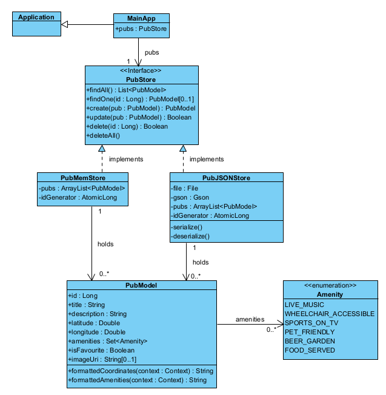
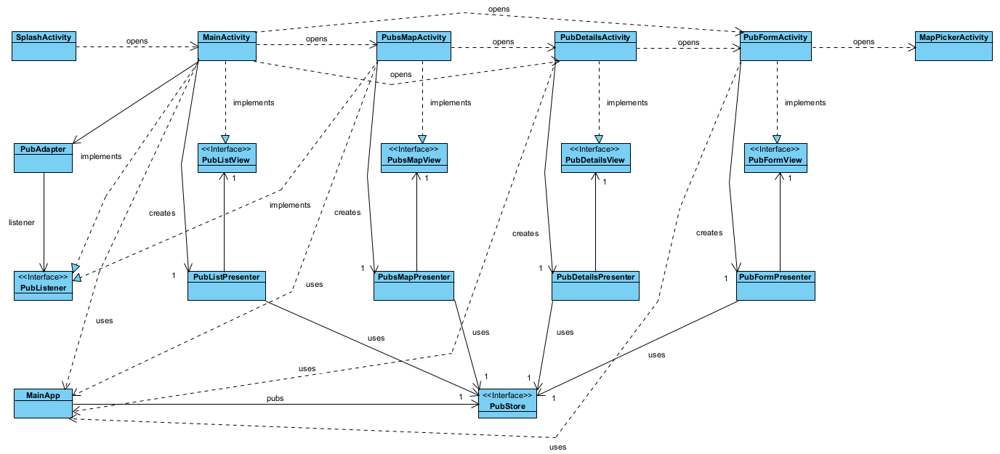
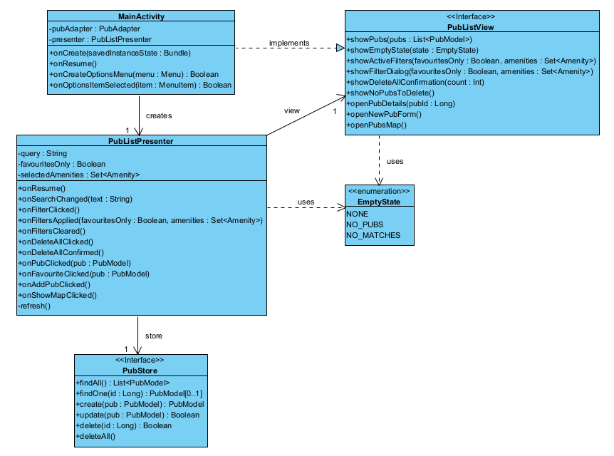

# 🍺 Pubs & Bars Finder

Pubs & Bars Finder is an Android app for discovering pubs and bars, helping users find the best venues to gather and socialise. Users can save the places they like with a photo, description, amenities and location, mark their favourites, see them all on a map, and share them with friends. All pubs are saved on the device.

## ✨ Features

- Splash screen with the app's logo and name when the app starts
- Add a pub with a title, description, photo, amenities, favourite status and coordinates
- Input validation: a title is required, and coordinates must be within valid ranges (a comma is accepted as the decimal separator). After a first save attempt, errors update as each field is corrected
- Add a photo to each pub from the device, with a preview, and change or remove it
- Choose a pub's location on a map by tapping or dragging a marker (OpenStreetMap)
- List all saved pubs as cards, showing the photo, description, formatted coordinates (for example 53.3448° N, 6.2765° W) and amenities
- Mark pubs as favourites, from the list, the details screen or the form
- Search pubs by title as you type, ignoring upper and lower case
- Filter the pub list by favourites and amenities, together with the search, with the active filters shown below the search field
- Empty-state messages when no pubs have been saved yet, or when no pubs match the search or filters
- Tap a pub to see its details: photo, full description, amenities, coordinates and a map of its location
- Edit, share and delete a pub from its details screen, with a confirmation before deleting
- Share a pub through any app (messaging, email and so on), including a Google Maps link to its location
- See all pubs on a map, and tap a marker to show that pub's card below the map
- Delete all pubs at once, with a confirmation showing how many will be deleted
- All pubs are saved to a JSON file, so they're kept when the app is closed
- Amenities: live music, wheelchair accessible, sports on TV, pet friendly, beer garden and food served
- Light and dark mode support, following the phone's theme
- Console (CLI) menu with full CRUD operations, including amenities and favourites, for testing the data layer

## 🛠️ Tech stack

- **Language:** Kotlin
- **Platform:** Android (minimum SDK 24, target SDK 36)
- **Architecture:** MVP (Model-View-Presenter)
- **UI:** XML layouts with ViewBinding, ConstraintLayout and Material Components, with shared styles
- **Lists:** RecyclerView with a custom adapter
- **Maps:** OSMdroid (OpenStreetMap)
- **Persistence:** JSON file with Gson
- **Logging:** Timber
- **Images:** Activity Result API (`OpenDocument`) with persistable URI permissions
- **IDE:** Android Studio

## 📁 Project structure

```
app/src/main/java/com/pubsbarsfinder/app/
├── MainApp.kt                 # Application class: creates the pub store and sets up Timber
├── adapters/
│   ├── PubAdapter.kt          # RecyclerView adapter and the shared pub card binding
│   └── PubListener.kt         # Click listener interface for pub cards
├── main/
│   └── Main.kt                # Console (CLI) runner
├── models/
│   ├── PubModel.kt            # Pub data class, Amenity enum and formatting helpers
│   ├── PubStore.kt            # Data store interface
│   ├── PubMemStore.kt         # In-memory store (used by the CLI)
│   └── PubJSONStore.kt        # JSON file store (used by the app)
├── presenters/
│   ├── PubListPresenter.kt    # Main screen logic and PubListView interface
│   ├── PubFormPresenter.kt    # Add/edit logic and PubFormView interface
│   ├── PubDetailsPresenter.kt # Details logic and PubDetailsView interface
│   └── PubsMapPresenter.kt    # Pubs map logic and PubsMapView interface
└── views/
    ├── SplashActivity.kt      # Splash screen
    ├── MainActivity.kt        # Pub list, search, filters and delete all
    ├── PubFormActivity.kt     # Add/edit form
    ├── PubDetailsActivity.kt  # Pub details, share and delete
    ├── PubsMapActivity.kt     # All pubs on a map, with the selected pub's card
    └── MapPickerActivity.kt   # Choose a location on a map

app/src/main/res/
├── layout/                    # Screen and list item layouts
├── menu/                      # Top bar menus
├── drawable/                  # Field and card backgrounds, icons and selectors
├── values/                    # Strings, colours, themes and shared styles
├── values-night/              # Colours for dark mode
└── values-v31/                # Splash screen theme for Android 12 and newer

docs/                          # UML class diagrams
```

## 🏗️ Design

- **MVP:** each screen with logic has a presenter and a view interface. The activity only displays data and forwards user actions, while the presenter holds the screen's state and works with the store, so the logic doesn't depend on Android views. The splash and map picker screens have no business logic, so they stay as plain views.
- **Data layer:** built around a `PubStore` interface, with two implementations: an in-memory store (`PubMemStore`) and a JSON file store (`PubJSONStore`). Screens only depend on the interface, so either implementation can be used without changing the rest of the app.
- **Persistence:** `PubJSONStore` saves every change to a JSON file in the app's private storage. Switching the app from the in-memory store only required changing one line in `MainApp`.
- **Application class:** `MainApp` is created once when the app starts. It creates the pub store and sets up Timber logging, and every screen gets the store from it.
- **Immutable model:** `PubModel` is a data class with read-only properties. Changes create updated copies with `copy()`, and every change goes through the store.
- **List interactions:** the card reports taps through the `PubListener` interface, which keeps the adapter independent of the screens. The card's binding is shared through one function, so the list and the pubs map show exactly the same card.
- **Maps:** the maps use OSMdroid with OpenStreetMap tiles, so no API key is needed. Every map screen handles the map's lifecycle (resume, pause, destroy and low memory) and shows the OpenStreetMap attribution.
- **Dark mode:** colours are named by their role (such as `text_primary` or `accent`), with a second set of values in `values-night/colors.xml`. Android picks the right set automatically, so no layout or code needs to know which mode is active.
- **Resources:** all user-visible text is defined in `strings.xml`, colours are named by their role in `colors.xml`, and section titles, labels and buttons use shared styles, so every screen looks consistent.


*Model and persistence: the pub model, the store interface and its two implementations.*


*Architecture overview: how the screens, view interfaces and presenters connect.*


*MVP in detail for the main screen. The other screens follow the same structure.*

## 🌿 Git workflow

- Work is planned and tracked with GitHub **issues**, grouped into **milestones**.
- Issues are categorised with **labels** according to the type of work.
- Each feature is developed on its own **branch**, linked to its issue, and merged into `main` through a **pull request**.
- Documentation and small changes are committed directly to `main`.
- Commit messages follow the [Conventional Commits](https://www.conventionalcommits.org/) style and reference the related issue.
- Releases are tagged on GitHub (v1.0 for Assignment 1, v2.0 for Assignment 2), with release notes generated from the merged pull requests.

## 🚀 How to run

1. Clone the repository:
   ```bash
   git clone https://github.com/guilhermeoliveirateo/Pubs-Bars-Finder
   ```
2. Open the project in Android Studio and let Gradle sync.
3. Create or start an Android virtual device (Tools → Device Manager).
4. Run the app with **Run ▶** (Shift + F10).

The maps use OpenStreetMap, so no API key is needed, but the emulator needs an internet connection to load them. To test photos, drag a few images onto the emulator window first, so they appear in its Downloads folder.

To run the console menu instead, open `main/Main.kt` and click the ▶ icon next to `fun main()`, then choose **Run 'MainKt'**. The menu appears in the Run window.

## 📚 References

- [Kotlin documentation](https://kotlinlang.org/docs/home.html)
- [Android developer documentation](https://developer.android.com/)
- [RecyclerView](https://developer.android.com/develop/ui/views/layout/recyclerview)
- [View binding](https://developer.android.com/topic/libraries/view-binding)
- [Sending simple data to other apps](https://developer.android.com/training/sharing/send)
- [Material Components for Android](https://github.com/material-components/material-components-android)
- [OSMdroid](https://github.com/osmdroid/osmdroid)
- [OpenStreetMap copyright and licence](https://www.openstreetmap.org/copyright)
- [Gson](https://github.com/google/gson)
- [Timber](https://github.com/JakeWharton/timber)
- [Activity Result API](https://developer.android.com/training/basics/intents/result)
- [App architecture guide](https://developer.android.com/topic/architecture)
- [ConstraintLayout](https://developer.android.com/develop/ui/views/layout/constraint-layout)
- [Styles and themes](https://developer.android.com/develop/ui/views/theming/themes)